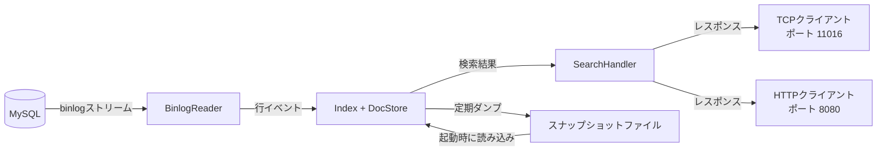
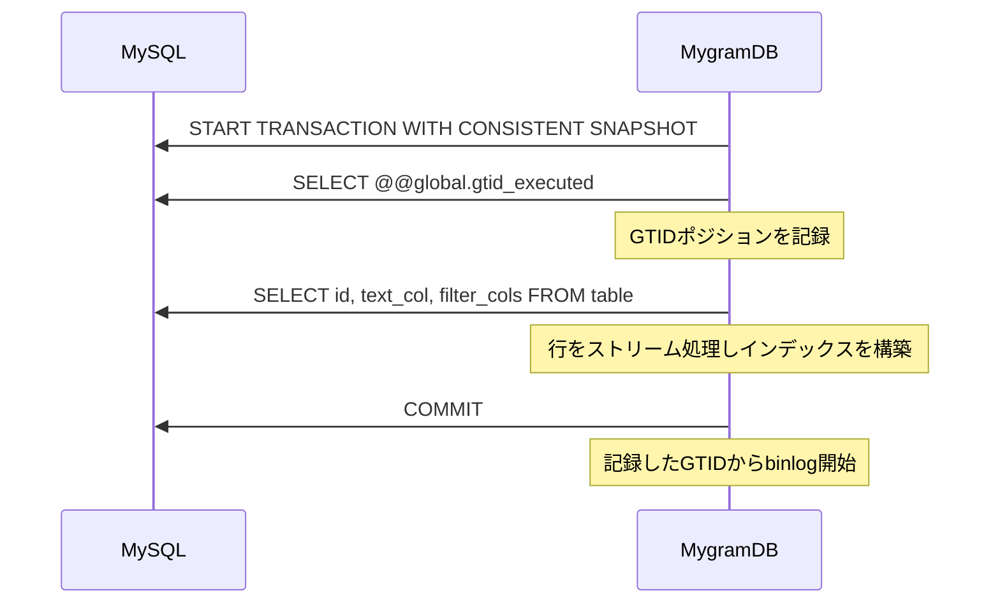
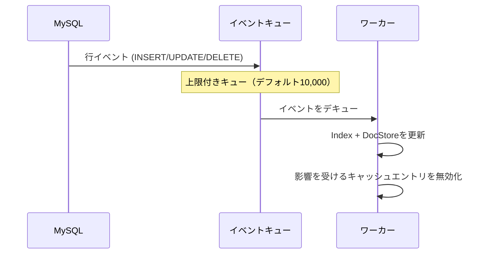
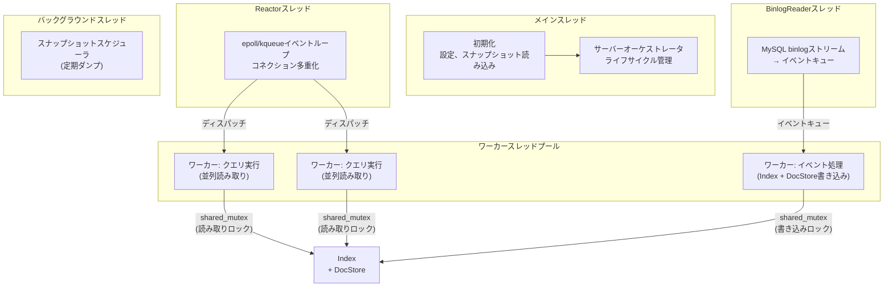
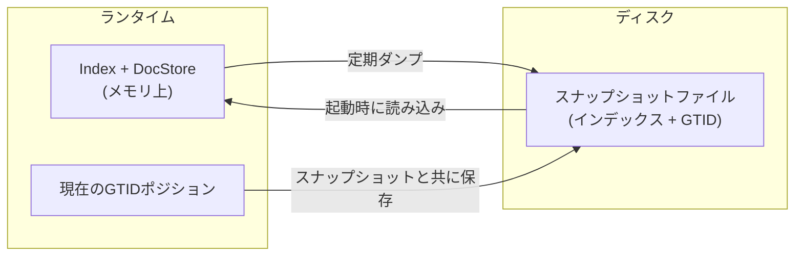
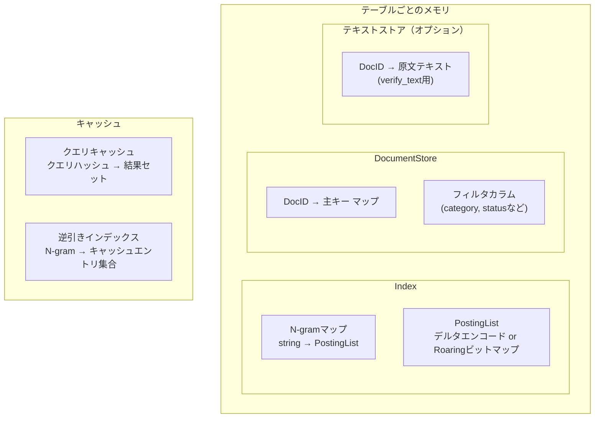

# アーキテクチャ

MygramDBはMySQL（8.4/9.x）またはMariaDB（10.6+/11.x）の横に置くサイドカープロセスとして動作します。接続先サーバーのバイナリログを読み取り、インメモリ全文インデックスを構築・維持し、TCPおよびHTTP経由で検索クエリに応答します。サーバー種別は `SELECT VERSION()` から自動判定されるため、同じバイナリと設定でどちらでも動作します。

重要なのは責務の境界です。MySQL/MariaDBは書き込みと通常のSQLを扱う永続データの正本であり、MygramDBはスナップショットとbinlog再生から再構築できる検索用インデックスを保持します。

::: info 用語補足
**サイドカー**は、既存のMySQLを置き換えず、横に追加して特定の役割だけを担うプロセスのことです。MygramDBの場合、MySQLは書き込みと通常のSQLを担当し、MygramDBは全文検索を担当します。
:::

## システム概要

**コンポーネント：**

- **BinlogReader** -- MySQLにレプリカとして接続し、GTIDベースのbinlogストリーミングで行レベルイベント（INSERT, UPDATE, DELETE）を受信します。
- **Index** -- インメモリN-gramインデックス。N-gram文字列からポスティングリスト（ソート済みドキュメントIDの集合）へのマップです。
- **DocumentStore** -- 内部DocIDからMySQL主キーへのマッピングを管理し、フィルタカラムの値を保持します。`verify_text`用にドキュメントテキストもオプションで保存します。
- **SearchHandler** -- クエリを解析し、検索パイプラインを実行し、クエリキャッシュを管理します。
- **Snapshot** -- インデックス状態とGTIDポジションを定期的にディスクにダンプし、高速な再起動を実現します。

::: info 用語補足
**DocStore** は検索結果を返すための補助データ置き場です。インデックスは検索候補を速く見つけるための構造、DocStoreは主キーやフィルタ値など結果表示・絞り込みに必要な情報を持つ構造です。
:::

## データフロー

MygramDBは大きく3つのフェーズで動作します。

### フェーズ1：初期スナップショット

`SYNC` 実行時、または `replication.auto_initial_snapshot: true` が設定されている場合、MygramDBはソーステーブルの一貫性のあるスナップショットを取得します。デフォルトは `auto_initial_snapshot: false` なので、本番運用では初回MySQL読み取りのタイミングを明示的に選びます。

これにより、スナップショット取得時点と、その後に読むbinlogイベントの境界を揃えます。

### フェーズ2：ライブレプリケーション

初期スナップショット後、MygramDBはbinlogストリーミングに切り替わります：

BinlogReaderスレッドがイベントを上限付きキューに読み込み、ワーカースレッドがイベントを取り出してインデックスとドキュメントストアに適用します。この分離により、短いバースト時でもbinlogリーダーがMySQLの変更を読み進めやすくなります。

接続切断時は指数バックオフ（500msから10s）で再接続し、最後に処理したGTIDポジションから再開します。

### フェーズ3：クエリ処理

検索クエリはTCP（ポート11016、デフォルト）またはHTTP（ポート8080、デフォルトでは無効）経由で到着し、[検索パイプライン](/ja/docs/how-it-works#検索パイプライン)を通して処理されます。

## スレッドモデル

v1.5.3以降、MygramDBはTCP接続に**イベント駆動Reactor I/Oモデル**を採用しています。Reactorはepoll (Linux) またはkqueue (macOS) を使用して数千の接続を単一のイベントループスレッドで多重化し、上限付きのワーカープールにディスパッチします。

::: info 用語補足
**Reactor I/Oモデル**は、多数の接続を少数のスレッドで監視し、実際に処理が必要になったときだけワーカーへ渡す方式です。接続ごとにスレッドを作らないため、アイドル接続が多い環境でもスレッドを浪費しません。
:::

**並行性モデル：**

- **Reactor**スレッドがすべてのTCP I/O（accept、read、write）をepoll/kqueueで処理します。接続ごとにスレッドを作る方式ではないため、数千のアイドル接続があってもスレッドを消費しません。
- パースされたリクエストは**ワーカースレッドプール**にディスパッチされ、クエリが実行されます。
- IndexとDocumentStoreは`std::shared_mutex`で保護されており、単一のライターと複数の同時リーダーが共存できます。
- 検索クエリは読み取りロックを取得し、binlogイベント処理は書き込みロックを取得します。
- これは読み取り主体のワークロードに最適です。検索同士は互いにブロックせず、書き込みはインデックス更新中に短時間だけブロックします。
- コネクション単位の**バックプレッシャー**（`api.tcp.max_write_queue_bytes`、デフォルト16 MiB）により、書き込みキューが上限を超えた低速クライアントを強制切断し、メモリ枯渇を防止します。
- アトミックカウンターが統計情報（クエリ数、キャッシュヒット率）に使用され、ホットパスでのロック競合を回避します。

::: info 用語補足
**バックプレッシャー**は、遅いクライアントに合わせてサーバー側の送信待ちデータが増え続けないように制限する仕組みです。上限を超えた接続を切ることで、1つの接続がプロセス全体のメモリを使い切ることを防ぎます。
:::

すべてのスレッドはシャットダウン時にjoinされます。デタッチされるスレッドはありません。

## 永続化

MygramDBは**スナップショットベースの永続化**を採用しており、WAL（Write-Ahead Log）は使用しません。

::: info 用語補足
**WAL** は変更を逐次ログに書く方式です。MygramDBはMySQLを正本として扱うため、独自WALではなく「定期ダンプ + MySQL binlogからの追いつき」で復旧します。
:::

**仕組み：**

1. バックグラウンドスケジューラが定期的にインデックス、ドキュメントストア、現在のGTIDポジションをディスクにシリアライズします。
2. 再起動時にMygramDBはスナップショットを読み込み、保存されたGTIDからbinlogレプリケーションを再開します。
3. スナップショットと現在のMySQLポジションの間のイベントは自動的に再適用されます。

v1.5.0以降、スナップショット書き込みは**アトミックなファイル操作**（一時ファイルに書き込み後リネーム）を使用し、ダンプ中にプロセスが中断されてもファイル破損を防止します。

スナップショットを読み込んでいない場合は、`SYNC <table>`（複数DB構成では `SYNC <database>.<table>`）を実行して初期スナップショットを作成します。起動時の自動スナップショットは `replication.auto_initial_snapshot` を明示的に有効にした場合だけ実行されます。

::: warning MySQLバックアップの代替ではありません
MygramDBのスナップショットは検索インデックスを復旧するためのものです。MySQL本体のバックアップやポイントインタイムリカバリは、MySQL側で別途用意してください。
:::

## メモリレイアウト

**サイジングの参考値**（110万件のWikipedia記事、平均666文字）：

| コンポーネント | メモリ |
|--------------|--------|
| Index（N-gramマップ + ポスティングリスト） | 約813 MB |
| DocumentStore + テキストストア | 約1.54 GB |
| **RSS合計** | **約2.53 GB** |

テキストストアは`verify_text`が有効な場合にのみ割り当てられます。無効の場合、同じデータセットでのメモリ使用量は約813 MBです。

ポスティングリストが最大のコンポーネントです。メモリ効率は圧縮戦略に依存します。疎なN-gramにはデルタエンコーディング、密なN-gramにはRoaringビットマップが使用されます。適応的圧縮の詳細は[仕組み](/ja/docs/how-it-works#ポスティングリスト圧縮)をご覧ください。

---

検索パイプラインの詳細は[仕組み](/ja/docs/how-it-works)を、パフォーマンスの数値は[ベンチマーク](/ja/benchmarks)をご覧ください。
